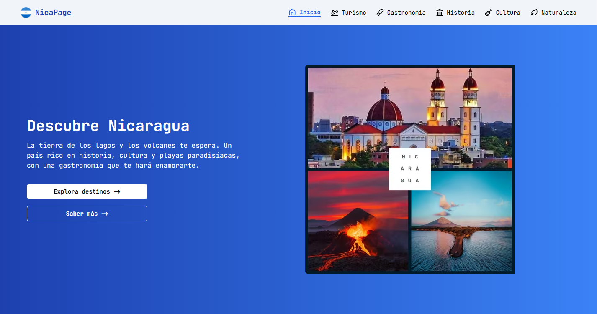

# NicaPage

[](https://github.com/14BryanEspinoza/nica-page/actions/workflows/deploy.yml)
[](https://github.com/14BryanEspinoza/nica-page/actions/workflows/ci.yml)
[](LICENSE)

> Guía turística de **Nicaragua** construida con **Astro 7** (SSG) y **Tailwind CSS v4**: destinos, gastronomía, historia, cultura, flora y fauna, con 47 entradas de contenido gestionadas por **Content Collections** (validadas con Zod en build) y despliegue automático en GitHub Pages.



---

## 🌐 Demo en vivo

**<https://14bryanespinoza.github.io/nica-page/>**

---

## 🚀 Inicio rápido

```bash
pnpm install   # instalar dependencias
pnpm dev       # desarrollo local → http://localhost:4321/nica-page/
pnpm preview   # previsualizar el build
```

**Verificación** — los cuatro checks deben pasar en `0`:

```bash
pnpm format:check   # Prettier
pnpm lint           # ESLint
pnpm check          # Astro check (TypeScript)
pnpm build          # Build de producción
```

> **Node requerido:** ≥ 22.12.0 (`engines` en `package.json` y workflow CI).

---

## 🗺️ Rutas

| Ruta                | Página        | Contenido                                                                        |
| ------------------- | ------------- | -------------------------------------------------------------------------------- |
| `/`                 | Inicio        | Hero, video de descubre, destinos y sabores destacados, CTA                      |
| `/tourism/`         | Turismo       | 11 destinos: playas, ciudades coloniales, islas y rutas culturales               |
| `/gastronomy/`      | Gastronomía   | 10 platos típicos con ingredientes y origen                                      |
| `/gastronomy/[id]/` | Detalle       | Página por plato (gallo pinto, nacatamal, indio viejo, vigorón, quesillo…)       |
| `/history/`         | Historia      | Línea del tiempo de época precolombina a la revolución sandinista + curiosidades |
| `/culture/`         | Cultura       | Tradiciones, celebraciones y patrimonio inmaterial                               |
| `/nature/`          | Naturaleza    | 16 especies de flora y fauna, áreas protegidas y deportes de aventura            |
| `/nature/[id]/`     | Detalle       | Página por especie (guardabarranco, jaguar, sacuanjoche, ceiba…)                 |
| `/404`              | No encontrada | Página de error personalizada                                                    |

---

## ✨ Características

- **Astro 7 (SSG)** — HTML estático por página con View Transitions (`<ClientRouter />`) y **prefetch** de rutas.
- **Content Collections** — 47 entradas Markdown en 4 colecciones (`destination`, `gastronomy`, `nature`, `history`) validadas con **Zod** en build: si un frontmatter falta o es inválido, el build falla en vez de publicar contenido roto.
- **Tailwind CSS v4 (CSS-first)** — configuración vía `@theme` con design tokens.
- **Imágenes optimizadas en build** — `astro:assets` + Sharp con variantes **AVIF/WebP**: las cards usan `<Picture />` con `srcset` y `loading="lazy"`.
- **SEO por página** — `title`, `description` y `keywords` únicos por ruta, `canonical` y Open Graph dinámicos, más `@astrojs/sitemap` y `robots.txt`.
- **Contenido íntegramente en español neutro** (`lang="es"`): copy, `alt` descriptivos (`imageAlt`), `aria-label` y meta tags.
- **Iconos** — astro-icon con Lucide y Simple Icons.
- **Calidad de código** — TypeScript strict (0 `any`), ESLint + Prettier, Husky + lint-staged y CI en cada push/PR.

---

## 📁 Estructura del proyecto

```text
src/
├── assets/              # Imágenes por sección (adventure, culture, destinations, gastronomy, history, nature, video)
├── components/          # Componentes reutilizables (Cards, CitiesCard, ContainerText, Datalist, ItemList, Link, Navbar, Tag, Timeline)
├── content/             # Colecciones Markdown (destinations, flora-fauna, gastronomy, history)
├── content.config.ts    # Schemas Zod de las colecciones + procesamiento de imágenes
├── data/                # Datos estructurados (links, culture, celebrations, curiosities, protected-areas, sports-adventures)
├── layouts/             # Shell HTML y secciones (Layout, LayoutPage, Footer, Hero, Cities, Meals, Traditions…)
├── metadata/            # Configuración SEO y Open Graph (metadata.ts)
├── pages/               # Rutas (index, tourism, gastronomy + [id], history, culture, nature + [id], 404)
└── styles/              # Estilos globales y tokens de diseño (global.css)
public/
├── favicon.png
├── robots.txt
└── preview.png          # Imagen Open Graph / Twitter Card
```

---

## 🛠️ Comandos

```bash
# Instalar dependencias (pnpm)
pnpm install

# Desarrollo local (http://localhost:4321/nica-page/)
pnpm dev

# Build de producción (genera dist/)
pnpm build

# Preview del build local
pnpm preview

# Lint + solución automática
pnpm lint
pnpm lint:fix

# Formato
pnpm format
pnpm format:check

# Verificación de tipos TypeScript y Astro
pnpm check
```

---

## 🌐 Despliegue

- **CI** (`.github/workflows/ci.yml`) — lint, formato, typecheck y build en cada push y PR a cualquier rama.
- **Deploy** (`.github/workflows/deploy.yml`) — en push a `main`:

1. **Job `build`** — `withastro/action@v6` (Node 22) → `pnpm install` + `pnpm build` → sube `dist/` como artifact.
2. **Job `deploy`** — `actions/deploy-pages@v4` → publica el artifact en el entorno `github-pages`.

URL final: **<https://14bryanespinoza.github.io/nica-page/>**

> La configuración de base path en `astro.config.mjs`:

```js
{
  site: "https://14bryanespinoza.github.io/nica-page/",
  base: "/nica-page/",
  build: { assets: "assets" }
}
```

---

## 📦 Contenido y datos

- **`content.config.ts`** — esquemas Zod por colección: `commonSchema` extendido para cada tipo, `image()` tipado y campos específicos (`scientificName`, `conservationStatus`, `highlights`, `order`…).
- **`destinations/`** (11) — fichas de destino con `attractions` y `moreInfoUrl`.
- **`flora-fauna/`** (16) — 8 fauna + 8 flora con nombre científico, hábitat y estado de conservación.
- **`gastronomy/`** (10) — platos con ingredientes, etiqueta y origen.
- **`history/`** (10) — hitos con `yearRange`, `order` y `highlights`; son los únicos con cuerpo en Markdown (línea del tiempo).
- **`links.ts`** — enlaces de Navbar y pie construidos sobre `import.meta.env.BASE_URL` (sin rutas hardcodeadas).
- **`culture.ts` / `celebrations.ts` / `curiosities.ts`** — tradiciones, fiestas patronales y datos curiosos.
- **`protected-areas.ts` / `sports-adventures.ts`** — selección de áreas protegidas (Indio Maíz, Volcán Masaya, Miraflor…) y deportes de aventura.

---

## ♿ Accesibilidad

- **Skip link** "Saltar al contenido principal" al inicio del `body`.
- **Menú móvil con `<button>`** real y `aria-expanded`/`aria-controls` sobre el `nav`.
- **`prefers-reduced-motion`** respetado: animaciones y revelados se desactivan si el usuario lo pide.
- **HTML5 semántico** (`header`, `main`, `section`, `footer`, `nav`) con jerarquía de encabezados consistente.
- **`alt` descriptivos en español** en todas las imágenes de contenido (`imageAlt` en cada entrada).
- **Anillos de enfoque visibles** (`:focus-visible`) en todo el sitio.

---

## ⚡ Performance & optimización

| Optimización                    | Implementación                                         | Resultado medido (este build)           |
| ------------------------------- | ------------------------------------------------------ | --------------------------------------- |
| **Video con poster**            | Sin autoplay: `poster` webp (38 KB) + `preload="none"` | 9.2 MB → 0 KB hasta que el usuario play |
| **Imágenes AVIF + WebP**        | `astro:assets` + Sharp con `srcset` y `loading="lazy"` | Ej.: 1.65 MB → 39 KB (AVIF) por imagen  |
| **Content Collections**         | Frontmatter validado con Zod durante `astro build`     | 0 contenido roto publicado              |
| **View Transitions + prefetch** | `<ClientRouter />` + `prefetch: true`                  | Navegación sin recargas completas       |
| **HTML por página**             | SSG completo (33 páginas)                              | Estático, sin JS de fetching en runtime |
| **Sitemap + robots**            | `@astrojs/sitemap` + `public/robots.txt`               | Indexación SEO automática               |

---

## 🔧 Stack técnico

| Herramienta         | Versión    | Uso                                                           |
| ------------------- | ---------- | ------------------------------------------------------------- |
| Astro               | 7.x        | SSG, rutas dinámicas y optimización de assets                 |
| Tailwind CSS        | 4.x        | Estilos utility-first y design tokens vía `@tailwindcss/vite` |
| astro-icon          | 1.x        | Iconos SVG (Lucide y Simple Icons)                            |
| @astrojs/sitemap    | 3.x        | Generación automática de `sitemap.xml`                        |
| Sharp               | 0.35.x     | Procesamiento y conversión de imágenes en build               |
| TypeScript          | 5.x        | Tipado estricto (tsconfig `strict`)                           |
| ESLint              | 10.x       | Linting de código (plugins para Astro y Tailwind)             |
| Prettier            | 3.x        | Formateador de código                                         |
| Husky / lint-staged | 9.x / 17.x | Automation de git pre-commit hooks                            |

---

## ⚠️ Limitaciones conocidas

- Los enlaces legales del pie (Términos, Privacidad, Cookies) apuntan a `#` y no hay canal de contacto: son placeholders hasta que existan esas páginas.

---

## 📝 Licencia

MIT — libre para uso personal y educativo.
